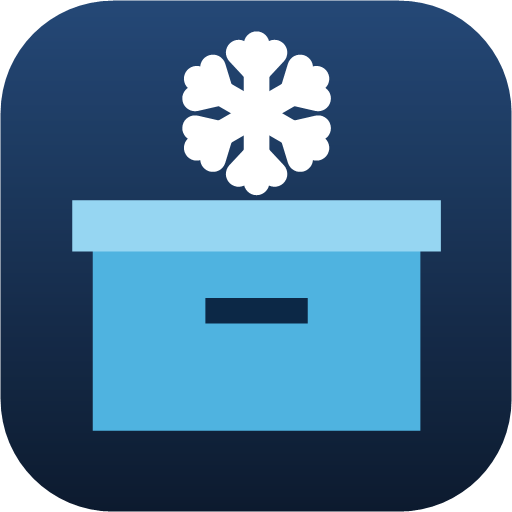
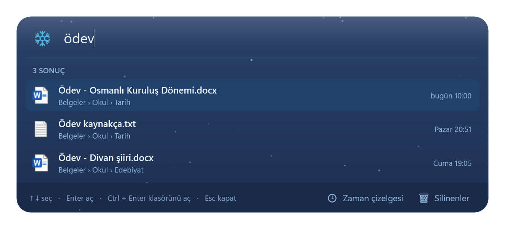
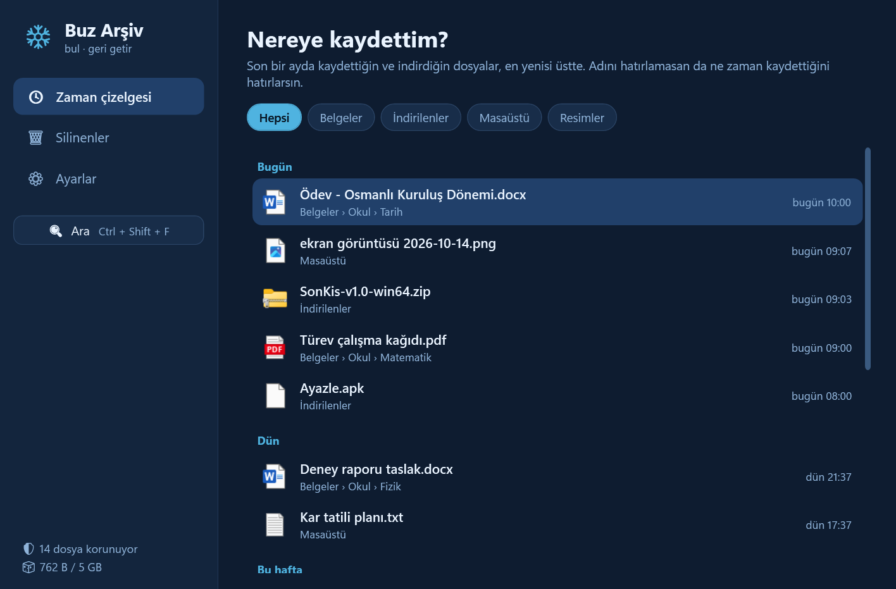
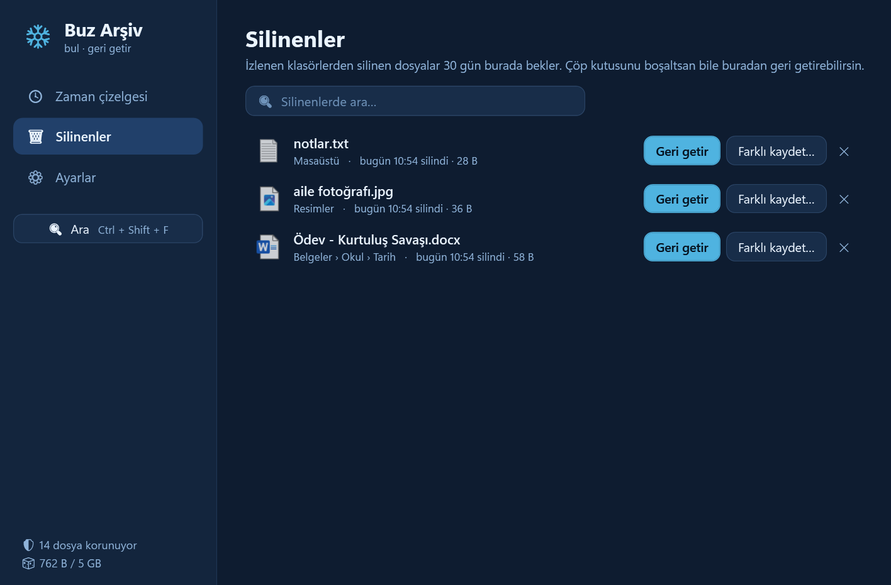

<div align="center">



# Buz Arşiv

**"O dosyayı nereye kaydettim?" ve "Yanlışlıkla sildim!" dertlerine tek çözüm. ❄️**

[](https://github.com/Enskygr234/buz-arsiv/releases/latest)
[](https://dotnet.microsoft.com/download/dotnet/8.0)
[](LICENSE)



</div>

## Ne yapar?

**🔍 Bul:** `Ctrl + Shift + F`'ye bas, buzlu bir arama çubuğu açılır. Dosya adının bir parçasını yaz; anında listelenir. Türkçe harfleri dert etme: `odev` yazınca *Ödev* de çıkar. Enter dosyayı, Ctrl + Enter klasörünü açar.

**🕓 Nereye kaydettim?** Adını hatırlamıyorsan ne zaman kaydettiğini hatırlarsın. Zaman çizelgesi son bir ayda kaydettiğin ve indirdiğin her şeyi *Bugün, Dün, Bu hafta* diye gruplar. Klasöre göre süzebilirsin.

**🗑 Silinenleri geri getir:** Buz Arşiv izlediği klasörlerdeki dosyaların son hâlinin kopyasını sessizce saklar. Bir dosya silinince (çöp kutusu boşaltılsa bile) **Silinenler**'den tek tıkla geri gelir.

| Zaman çizelgesi | Silinenler |
|---|---|
|  |  |

## Kurulum

1. [Son sürümden](https://github.com/Enskygr234/buz-arsiv/releases/latest) `BuzArsiv.exe` dosyasını indir ve çalıştır.
2. Bildirim alanında (saatin yanında) buzlu kutu simgesi belirir. Artık `Ctrl + Shift + F` ile arayabilirsin.
3. Bilgisayar açılınca kendiliğinden başlasın istersen: **Ayarlar → Windows açılınca Buz Arşiv de başlasın**.

Çalışması için [.NET 8 Desktop Runtime](https://dotnet.microsoft.com/download/dotnet/8.0) gerekir. Windows "bilinmeyen yayıncı" uyarısı gösterirse **Ek bilgi → Yine de çalıştır** de; exe imzalı olmadığı için çıkar.

## Nasıl çalışır?

- **İzlenen klasörler:** Varsayılan olarak Masaüstü, Belgeler, İndirilenler ve Resimler. Ayarlardan klasör ekleyip çıkarabilirsin.
- **Arama:** Açılışta klasörleri bir kez tarar, sonra Windows'un dosya bildirimleriyle güncel kalır. Bütün liste bellekte durduğu için arama anında sonuç verir.
- **Buzdolabı:** Her dosyanın son hâli `%LocalAppData%\BuzArsiv\buzdolabi` klasörüne kopyalanır. Aynı içerik iki kez saklanmaz. İlk açılışta var olan dosyalar yavaş yavaş, bilgisayarı yormadan kopyalanır.
- **Akıllı silme algılama:** Taşınan ya da adı değişen dosyalar silinmiş sayılmaz. Word ve Excel gibi programların kaydederken dosyayı silip yeniden yazması da silme sayılmaz.

### Sınırlar (ayarlardan değişir)

| Ayar | Varsayılan |
|---|---|
| Bundan büyük dosyaları koruma | 50 MB |
| Buzdolabı en fazla | 5 GB (dolunca önce en eski silinenler çıkar) |
| Silinenleri saklama süresi | 30 gün |

> Buz Arşiv yalnızca **kurulduktan sonra** silinen dosyaları geri getirebilir. Kopyalar yalnızca bu bilgisayarda durur; internete hiçbir şey gönderilmez.

## Kaynaktan derle

[.NET 8 SDK](https://dotnet.microsoft.com/download/dotnet/8.0) ile `build.bat` dosyasını çalıştır; `EXE\BuzArsiv.exe` oluşur.

Çekirdeğin (arama dizini ve buzdolabı) testleri gerçek dosyalarla çalışır:

```
dotnet run --project Testler
```

## Tasarım

Ad, buzlu arama çubuğu artı pencere düzeni, `Ctrl + Shift + F` kısayolu ve özellik seçimi (silinenleri kurtarma, "nereye kaydettim?" zaman çizelgesi) Winterdeveloper'ın kararları. Kodu Claude ile birlikte yazıldı.

## Lisans

[MIT](LICENSE) © Winterdeveloper
